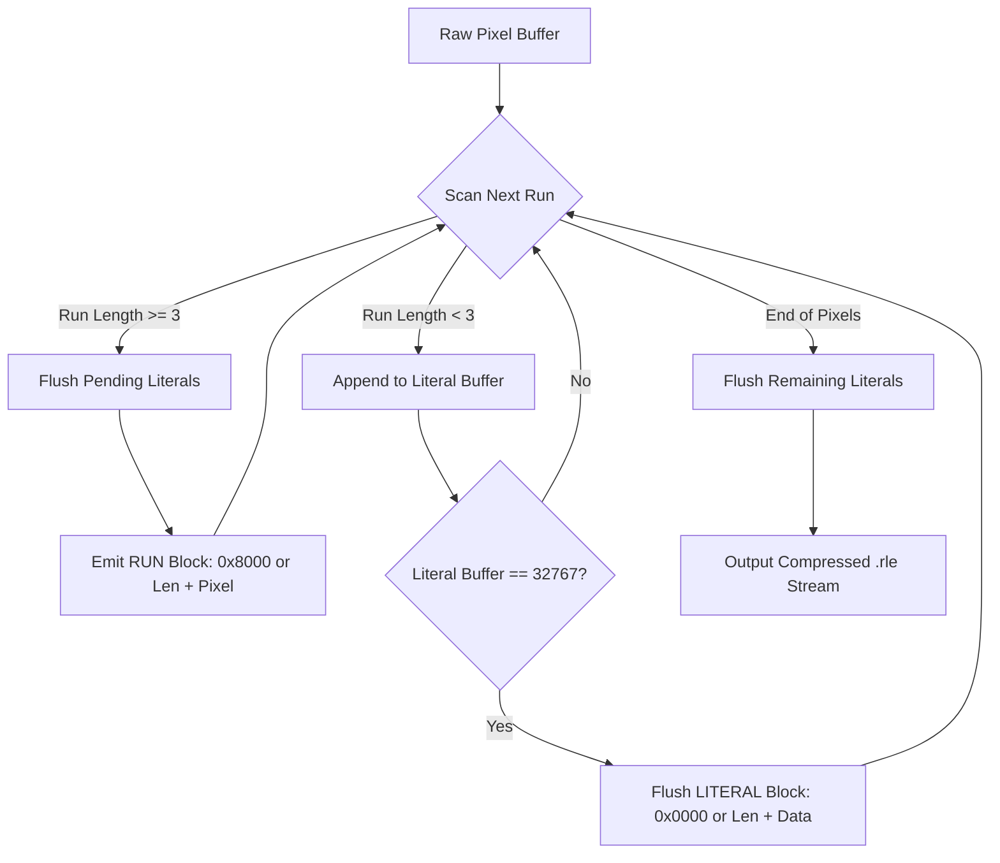

<div align="center">

# 🗜️ Codec-RLE: Binary Image Compression & Interactive Studio

[](https://www.python.org/)
[](https://www.python.org/)
[](https://docs.python.org/3/library/tkinter.html)
[](LICENSE)

**A high-performance Run-Length Encoding (RLE) codec and dual-canvas pixel editor designed for binary bitmap graphics.**

[Key Features](#-key-features) • [Binary Format Protocol](#-binary-format-specification) • [Getting Started](#-getting-started) • [GUI Guide](#-interactive-gui-controls) • [Project Architecture](#-project-architecture)

---

</div>

## 📌 Overview

**Codec-RLE** is a complete end-to-end lossless image compression suite built from scratch in Python. It couples a bit-packed **Run-Length Encoding (RLE)** engine with an interactive **Tkinter pixel art studio**, allowing you to draw binary images (black & white), inspect compression ratios in real time, and verify side-by-side lossless decompression instantly.

```
       [ Drawing Canvas ]                          [ Decompressed View ]
   ┌────────────────────────┐                  ┌────────────────────────┐
   │ ■ ■ ■ ■ □ ■ □ □ ■ ■ ■  │                  │ ■ ■ ■ ■ □ ■ □ □ ■ ■ ■  │
   │ ■ ■ ■ ■ □ ■ □ □ ■ ■ ■  │                  │ ■ ■ ■ ■ □ ■ □ □ ■ ■ ■  │
   │ □ □ □ □ □ □ □ □ □ □ □  │                  │ □ □ □ □ □ □ □ □ □ □ □  │
   └───────────┬────────────┘                  └───────────▲────────────┘
               │                                           │
               ▼                                           │
      [ codec.encode() ]                          [ codec.decode() ]
               │                                           │
               └─────────►  .rle Binary Stream  ───────────┘
                           (16-bit Header + Blocks)
```

---

## 📸 Screenshot


---

## ✨ Key Features

- 🎨 **Interactive Dual-Canvas Studio**: Draw on an editable grid (up to 200×200 resolution) and see real-time side-by-side decompressed results.
- ⚡ **Optimized Hybrid Encoding**: Intelligently switches between **Run Blocks** and **Literal Blocks** to prevent data inflation on high-frequency noise.
- 📐 **Custom 16-Bit Block Protocol**: Supports run lengths and literal spans up to **32,767 pixels** per block with automatic stream chunking.
- 📊 **Real-time Compression Metrics**: Displays file size differences, compression ratio (%), and net bandwidth saved.
- 🔍 **Compression Details Panel**: A scrollable per-block report showing block type, header bytes, pixel count, byte cost, and content preview — powered by `codec.analyze()`.
- 💾 **Dual File I/O Format**: Supports exporting and importing uncompressed `.raw` images and compressed `.rle` archives.
- 🛡️ **Zero External Dependencies**: Standard Python standard library only (`tkinter`, `os`).

---

## 🔬 Binary Format Specification

Every `.rle` and `.raw` file begins with a fixed **4-byte Big-Endian Header** followed by the payload:

### 1. File Header (4 Bytes)

```
 0                   1                   2                   3
 0 1 2 3 4 5 6 7 8 9 0 1 2 3 4 5 6 7 8 9 0 1 2 3 4 5 6 7 8 9 0 1
+-+-+-+-+-+-+-+-+-+-+-+-+-+-+-+-+-+-+-+-+-+-+-+-+-+-+-+-+-+-+-+-+
|          WIDTH (16-bit)       |        HEIGHT (16-bit)        |
+-+-+-+-+-+-+-+-+-+-+-+-+-+-+-+-+-+-+-+-+-+-+-+-+-+-+-+-+-+-+-+-+
```

### 2. Uncompressed Payload (`.raw`)

After the 4-byte header, the `.raw` file contains exactly `width × height` raw pixel bytes — one byte per pixel (`0x00` = black, `0xFF` = white).

### 3. Compressed Stream Blocks (`.rle`)

The compressed payload consists of variable-length blocks. Each block begins with a **16-bit control descriptor**:

```
 0                   1
 0 1 2 3 4 5 6 7 8 9 0 1 2 3 4 5
+-+-+-+-+-+-+-+-+-+-+-+-+-+-+-+-+
|F|      COUNT (15-bit)         |  --> F = 1: RUN BLOCK | F = 0: LITERAL BLOCK
+-+-+-+-+-+-+-+-+-+-+-+-+-+-+-+-+
```

| Block Type | Flag Bit (Bit 15) | Count Range | Payload Structure | Total Size |
| :--- | :---: | :---: | :--- | :---: |
| **RUN Block** | `1` (`0x8000`) | 1 ≤ N ≤ 32767 | 1 byte: pixel value (`0x00` or `0xFF`) | **3 Bytes** |
| **LITERAL Block** | `0` (`0x0000`) | 1 ≤ N ≤ 32767 | N bytes: raw pixel stream | **2 + N Bytes** |

#### Why Hybrid RLE?

Encoding short runs (< 3 pixels) as run blocks adds 3 bytes of overhead, which causes negative compression. Our encoder applies an adaptive heuristic:
- Consecutive runs of **≥ 3 identical pixels** are packed into **Run Blocks** (`0x8000 | count` + pixel byte).
- Dispersed pixels or runs < 3 are coalesced into **Literal Blocks** (`0x0000 | count` + raw bytes).

---

## 🔄 Compression Pipeline



---

## 🚀 Getting Started

### Prerequisites

- Python 3.8 or higher installed on your system.
- Tkinter (included by default on Windows/macOS; on Linux: `sudo apt install python3-tk`).

### Installation

Clone this repository to your local machine:

```bash
git clone https://github.com/alphamoncif/Codec-RLE.git
cd Codec-RLE
```

### Launch the Application

```bash
python rle-app.py
```

---

## 🎮 Interactive GUI Controls

| Action | Control | Description |
| :--- | :--- | :--- |
| **Draw Black** | Left Click / Drag | Paints selected cell(s) black (`0x00`) |
| **Erase (White)** | Right Click / Drag | Restores selected cell(s) to white (`0xFF`) |
| **New Image** | Click `New` | Resets canvas to dimensions in Width/Height inputs |
| **Clear** | Click `Clear` | Resets current drawing to all-white |
| **Compress & Save** | Click `Compress & save` | Encodes active drawing and exports `.rle` file |
| **Open Compressed** | Click `Open compressed` | Loads & decodes `.rle` file into viewer canvas |
| **Save Raw** | Click `Save raw` | Exports uncompressed `.raw` pixel data |
| **Open Raw** | Click `Open raw` | Imports uncompressed `.raw` pixel data |

---

## 🔍 Compression Details Panel

After compressing or opening a `.rle` file, the **Compression Details** panel (bottom of the window) shows a full human-readable report generated by `codec.analyze()`:

```
=== COMPRESSION of output.rle ===
Image size        : 32 x 32 = 1024 pixels (512 black, 512 white)
Raw file size     : 1028 bytes  (4 header + 1024 pixel bytes)
Compressed size   : 312 bytes  (4 header + 308 RLE bytes)
Compression ratio : 30.4% of original  |  compression factor 3.30:1
Space saved       : 69.6%  (716 bytes)
Average bits/pixel: 2.437  (raw = 8.000)

Blocks            : 48 total = 32 RUN + 16 LITERAL
Pixels in runs    : 896  (87.5%)   |   in literals: 128  (12.5%)
Longest run       : 64 x WHITE (FF)
Bytes used by     : run blocks = 96, literal blocks = 212

   #  Offset  Type     Header   Count  Bytes  Content
----------------------------------------------------------------------
   1       0  RUN      8040      64      3    64 x WHITE (FF)
   2       3  LITERAL  0010      16      18   BWBWBWBWBWBWBWBW
   ...
```

The panel supports **horizontal and vertical scrolling** and shows up to 1 000 blocks.

---

## 📂 Project Architecture

```
Codec-RLE/
├── codec.py          # Core RLE encode() / decode() / analyze() engine
├── rle-app.py        # Tkinter studio, file I/O & compression report builder
├── .gitignore        # Ignores bytecache and IDE configuration files
└── README.md         # Documentation and project manual
```

### Module Responsibilities

#### `codec.py` — Compression Engine

| Function | Signature | Description |
| :--- | :--- | :--- |
| `encode` | `(pixels: bytes) → bytes` | Compresses a flat pixel buffer into an RLE stream |
| `decode` | `(data: bytes) → bytes` | Decompresses an RLE stream back to raw pixels |
| `analyze` | `(data: bytes) → list[dict]` | Parses a stream into block descriptors for the details panel |

#### `rle-app.py` — GUI & File I/O

| Function / Class | Description |
| :--- | :--- |
| `save_raw` / `load_raw` | Write/read uncompressed `.raw` files with the 4-byte header |
| `save_compressed` / `load_compressed` | Write/read `.rle` files (header + encoded stream) |
| `load_compressed_stream` | Reads a `.rle` file and returns the raw RLE stream without decoding |
| `build_report` | Generates the full human-readable compression report string |
| `PixelGrid` | Tkinter `Canvas` subclass — renders a pixel grid, handles draw/erase events |
| `App` | Main `Tk` application window, wires together all controls and panels |

---

## 📄 License

This project is licensed under the MIT License - see the [LICENSE](LICENSE) file for details.
